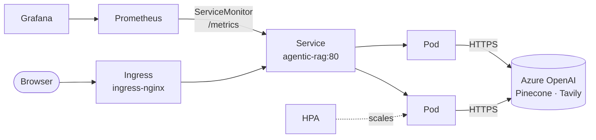

# Running the agent on Kubernetes

The same Docker image that runs on Azure Container Apps, deployed to Kubernetes with
security hardening, health probes, autoscaling and in-cluster Prometheus + Grafana.

The live demo still deploys to Azure Container Apps. This folder adds Kubernetes alongside it:
CI deploys the app to a throwaway [kind](https://kind.sigs.k8s.io/) cluster on every push to
prove the manifests work, and you can run the same setup on your laptop for free.

## What's here

```
k8s/
├── base/                       shared by every environment
│   ├── namespace.yaml          namespace with the "restricted" Pod Security Standard
│   ├── configmap.yaml          non-secret settings (provider, writable paths)
│   ├── deployment.yaml         probes, resources, non-root, read-only filesystem
│   ├── service.yaml            ClusterIP on port 80 -> 8080
│   ├── ingress.yaml            ingress-nginx, larger uploads, longer timeouts
│   ├── hpa.yaml                2-5 pods on CPU
│   ├── pdb.yaml                keeps one pod up during node maintenance
│   └── networkpolicy.yaml      in: HTTP only; out: DNS + HTTPS only
├── overlays/
│   ├── local/                  kind/minikube: local image, 1 pod, agentic-rag.localtest.me
│   └── aks/                    Azure Kubernetes Service: Docker Hub image, 2-5 pods
├── monitoring/
│   ├── kube-prometheus-stack-values.yaml   Prometheus + Grafana via Helm
│   └── servicemonitor.yaml                 scrape the app's /metrics
└── kind-config.yaml            local cluster with ports 80/443 mapped
```



## Design choices

| Concern | How it's handled |
|---|---|
| Secrets | API keys are a Kubernetes Secret built from your local `.env`; nothing secret is committed. On AKS, the next step is Azure Key Vault with the Secrets Store CSI driver. |
| Security | Runs as UID 10001, read-only root filesystem, all Linux capabilities dropped, no privilege escalation, no service-account token, namespace enforces the `restricted` Pod Security Standard. |
| Writable storage | The SQLite audit log and uploads go to a per-pod volume at `/var/lib/agentic-rag` (set through `AUDIT_DB_PATH` and `UPLOAD_DIR`). Each pod has its own audit log; a managed database would make it shared and durable. The knowledge base itself lives in Pinecone, so pods are otherwise stateless. |
| Availability | Rolling updates with `maxUnavailable: 0`, readiness/liveness/startup probes on `/api/health`, pods spread across nodes, PodDisruptionBudget. |
| Scaling | HorizontalPodAutoscaler on CPU (needs metrics-server). |
| Observability | The existing Grafana dashboard (`monitoring/grafana/.../agentic-rag.json`) is loaded into the in-cluster Grafana unchanged. |

## Run it on your laptop

You need [Docker Desktop](https://www.docker.com/products/docker-desktop/),
[kind](https://kind.sigs.k8s.io/docs/user/quick-start/#installation),
[kubectl](https://kubernetes.io/docs/tasks/tools/) and [Helm](https://helm.sh/docs/intro/install/).
On Windows: `winget install Kubernetes.kind Kubernetes.kubectl Helm.Helm`.

### With make (macOS, Linux, WSL)

```bash
make k8s-up           # cluster + ingress controller + metrics-server (~2 min)
make k8s-secrets      # copies your .env keys into the cluster
make k8s-deploy       # builds the image, loads it into kind, deploys
make k8s-status
# open http://agentic-rag.localtest.me

make k8s-monitoring   # Prometheus + Grafana (~3 min)
make k8s-grafana      # http://localhost:3000, admin / change-me

make k8s-down         # delete everything
```

### Without make (PowerShell)

```powershell
# 1. Cluster, ingress controller, metrics-server
kind create cluster --name agentic-rag --config k8s/kind-config.yaml
kubectl apply -f https://raw.githubusercontent.com/kubernetes/ingress-nginx/controller-v1.13.3/deploy/static/provider/kind/deploy.yaml
kubectl apply -f https://github.com/kubernetes-sigs/metrics-server/releases/latest/download/components.yaml
kubectl -n kube-system patch deployment metrics-server --type=json -p '[{\"op\":\"add\",\"path\":\"/spec/template/spec/containers/0/args/-\",\"value\":\"--kubelet-insecure-tls\"}]'

# 2. Your API keys from .env
kubectl create namespace agentic-rag
kubectl -n agentic-rag create secret generic agentic-rag-secrets --from-env-file=.env

# 3. Build and deploy
docker build -t agentic-rag:local .
kind load docker-image agentic-rag:local --name agentic-rag
kubectl apply -k k8s/overlays/local
kubectl -n agentic-rag rollout status deployment/agentic-rag
# open http://agentic-rag.localtest.me

# 4. Monitoring
helm repo add prometheus-community https://prometheus-community.github.io/helm-charts
helm upgrade --install monitoring prometheus-community/kube-prometheus-stack -n monitoring --create-namespace -f k8s/monitoring/kube-prometheus-stack-values.yaml --wait
kubectl apply -f k8s/monitoring/servicemonitor.yaml
kubectl -n monitoring create configmap agentic-rag-dashboard --from-file=agentic-rag.json=monitoring/grafana/provisioning/dashboards/agentic-rag.json
kubectl -n monitoring label configmap agentic-rag-dashboard grafana_dashboard=1
kubectl -n monitoring port-forward svc/monitoring-grafana 3000:80   # http://localhost:3000

# 5. Clean up
kind delete cluster --name agentic-rag
```

For Azure OpenAI, make sure `.env` contains `AZURE_OPENAI_ENDPOINT`, `AZURE_OPENAI_API_KEY`,
`PINECONE_API_KEY`, `TAVILY_API_KEY` and `ADMIN_API_KEY` (the ConfigMap already sets
`LLM_PROVIDER=azure`). After changing `.env`, run `make k8s-secrets` and restart the pods:
`kubectl -n agentic-rag rollout restart deployment/agentic-rag`.

### Things to try

```bash
kubectl -n agentic-rag get pods -w                                   # watch pods
kubectl -n agentic-rag logs -f deployment/agentic-rag                # app logs
kubectl -n agentic-rag delete pod -l app.kubernetes.io/component=api # self-healing
kubectl -n agentic-rag get hpa                                       # autoscaler status
```

kind's default network plugin doesn't enforce NetworkPolicies; AKS with Azure CNI or Calico does.

## Deploying to AKS later

The `aks` overlay is ready but not wired to CI, so nothing is created or billed until you choose to.

```bash
az group create -n agentic-rag-rg -l eastus2   # the existing group works too
az aks create -g agentic-rag-rg -n agentic-rag-aks --tier free \
  --node-count 1 --node-vm-size Standard_B2s --network-policy azure --generate-ssh-keys
az aks get-credentials -g agentic-rag-rg -n agentic-rag-aks
helm upgrade --install ingress-nginx ingress-nginx --repo https://kubernetes.github.io/ingress-nginx \
  -n ingress-nginx --create-namespace
kubectl create namespace agentic-rag
kubectl -n agentic-rag create secret generic agentic-rag-secrets --from-env-file=.env
# set your host in k8s/overlays/aks/kustomization.yaml, then:
kubectl apply -k k8s/overlays/aks

az aks stop  -g agentic-rag-rg -n agentic-rag-aks   # stop paying for nodes when idle
az aks start -g agentic-rag-rg -n agentic-rag-aks
```

## CI

The `kubernetes` job in `.github/workflows/tests.yml` runs on every push and pull request:

1. Renders both overlays with Kustomize and validates them with kubeconform.
2. Creates a kind cluster on the runner, builds the image and deploys the `local` overlay.
3. Waits for the rollout and checks `/api/health` and `/metrics` through the Service.
4. On failure, prints pod status, events and logs.

It runs alongside the Azure Container Apps pipeline and doesn't block the deployment.
